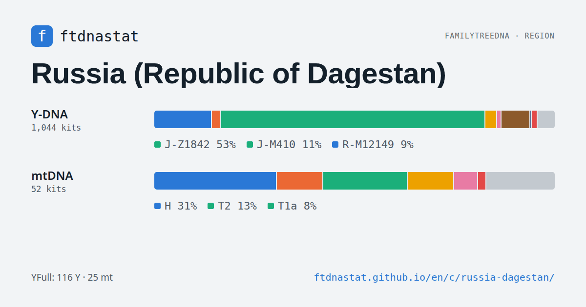
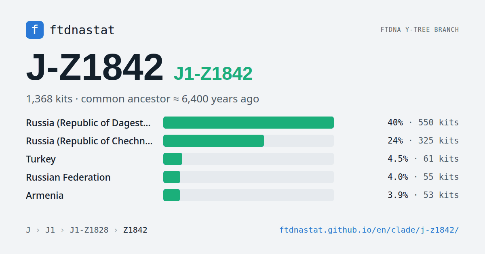
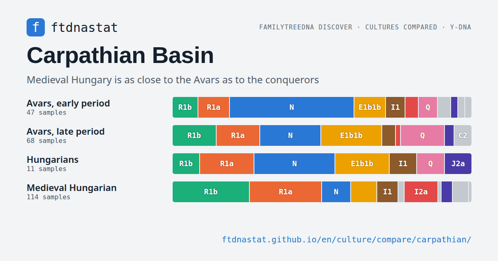

# ftdnastat — FTDNA and YFull haplogroups by country, people and branch

**Statistics of the public Y-DNA and mtDNA trees of FamilyTreeDNA and YFull: which countries and peoples the testers on each branch come from, how old the branch is, where the ancestors of geographic project members lived, and what ancient DNA shows.**

🌐 Language / Язык: **English** | [Русский](README.ru.md)

### 🔗 Open: **[ftdnastat.github.io](https://ftdnastat.github.io/)**

About 15,000 static pages in English and Russian; the site updates itself when a source publishes a new version.

## What is on the site

### 🗺 Countries and regions
294 countries and regions, including the republics of Russia and sub-regions such as Catalonia or Sicily. Each has a Y-DNA and an mtDNA branch tree with cumulative shares and ages, a comparison with the same country in YFull and on the FTDNA geographic project maps, findings, and the new kits and samples of the month.

### 🧬 A page for every branch
4,297 Y-DNA and 1,182 mtDNA branches. A branch page shows:
- the countries and peoples where it is most common, and a map of its share by country;
- where the ancestors of geographic project members on the branch lived, the branch centre and the circle holding 68% of its carriers;
- the age of the common ancestor by FamilyTreeDNA Discover, YFull and TheYtree;
- its sub-branches as a tree and a curve of how the branch grew over time;
- the Discover migration path and ancient samples from excavations.

### 👥 Peoples and regions in YFull
80 peoples by the native language YFull customers give, and 327 regions: branch make-up, similar neighbours, young branches shared across borders, combinations of paternal and maternal lines.

### 🏺 Ancient DNA and archaeological cultures
Ancient samples by country and epoch, about 600 culture pages, a comparison of two to four cultures by Y-DNA and mtDNA branches, and chains of cultures succeeding one another that show whether the people changed along with them.

### 🔎 Findings, comparison, changes
- **Findings** are recomputed on every build: signature branches of a region, similar countries, young widespread and old concentrated branches, disagreements between FTDNA and YFull.
- **Comparison** of countries and peoples along the branch tree.
- **Changes**: what appeared in the FTDNA trees each week and in YFull each month, new kits and samples of the month by country and branch.

## Data and limitations

- These are FamilyTreeDNA and YFull customers, not a population census: the country is the self-reported origin of the earliest known ancestor on the line, the people in YFull is the native language given. The US, Britain and Scandinavia are over-represented.
- Kits without a country are left out of country shares.
- Nested branches are never shown side by side: tree rows are cumulative, and a kit whose test did not go below a node is marked with an asterisk (`J-M172*`).
- Geographic project members chose whether to join and which ancestral place to give: the project maps show the sample, not the population.
- "Italy (Aosta Valley)" is shown as Orstkhoy, a people close to the Chechens and Ingush who report that region; sub-regions such as "Russia (Republic of Dagestan)" are separate from their country.

How the site gets its data, updates itself and computes shares, ages and findings: **[How ftdnastat works](https://ftdnastat.github.io/en/about/how/)**.

## Sources

- FamilyTreeDNA [Y-DNA Haplotree](https://www.familytreedna.com/public/y-dna-haplotree/) and [mtDNA Haplotree](https://www.familytreedna.com/public/mt-dna-haplotree/), and the public member maps of FamilyTreeDNA geographic projects.
- [FamilyTreeDNA Discover](https://discover.familytreedna.com/): branch ages, ancient samples, migration paths and the Mitotree.
- The public [YFull](https://www.yfull.com/tree/) Y-DNA and mtDNA trees.
- [TheYtree](https://www.theytree.com/), a third age estimate for Y-DNA branches.

## Sister project: ypredictor

[ypredictor.github.io](https://ypredictor.github.io/?lang=en) predicts a Y-tree branch from FTDNA STR markers and lists the closest matches. The two sites link to each other: the predictor opens a country page here, and country and branch pages here open the predictor and the branch's interactive tree.

Corrections of country and people names and ideas for new findings are welcome in the issues.
