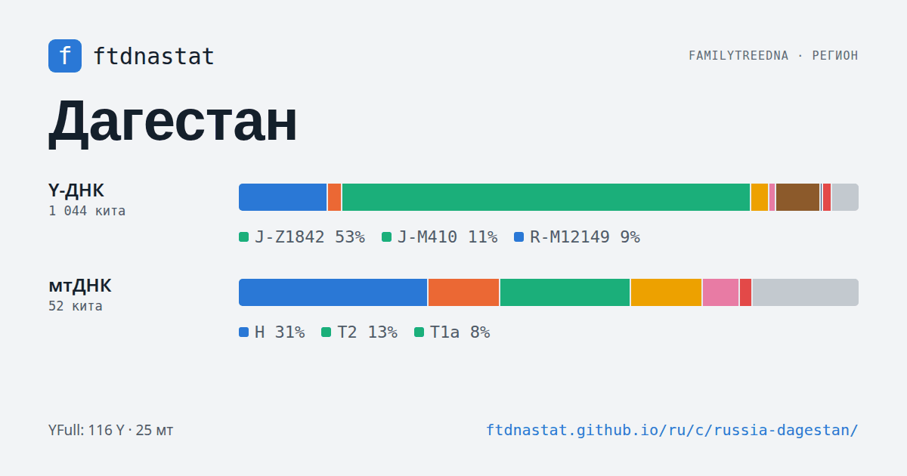
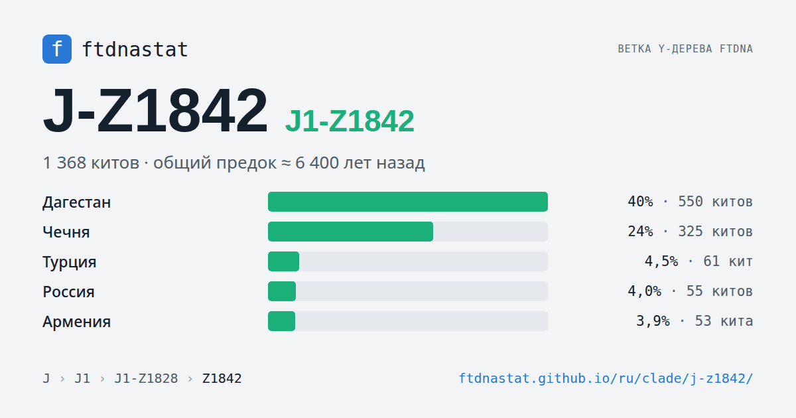
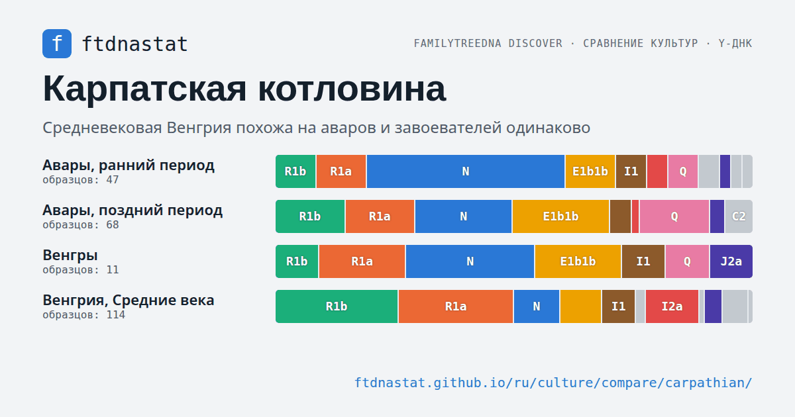

# ftdnastat — гаплогруппы FTDNA и YFull по странам, народам и веткам

**Статистика публичных деревьев Y-ДНК и мтДНК FamilyTreeDNA и YFull: из каких стран и народов люди на каждой ветке, сколько ветке лет, где жили предки участников гео-проектов и что показывает древняя ДНК.**

🌐 Language / Язык: [English](README.md) | **Русский**

### 🔗 Открыть: **[ftdnastat.github.io](https://ftdnastat.github.io/ru/)**

Около 15 тысяч статических страниц на русском и английском; сайт обновляется сам, когда у источников выходит новая версия.

## Что на сайте

### 🗺 Страны и регионы
294 страны и региона, включая республики России и субрегионы вроде Каталонии или Сицилии. У каждой — дерево ветвей Y-ДНК и мтДНК с накопительными долями и возрастами, сравнение с той же страной по YFull и по картам участников гео-проектов FTDNA, находки и новые киты и образцы за месяц.

### 🧬 Страница каждой ветки
4 297 веток Y-ДНК и 1 182 мтДНК. На странице ветки:
- страны и народы, где она чаще всего встречается, и карта долей по странам;
- где жили предки участников гео-проектов с этой веткой, центр ветки и круг, в котором живёт 68 % её носителей;
- возраст общего предка по FamilyTreeDNA Discover, YFull и TheYtree;
- подветки деревом и кривая того, как ветка разрасталась со временем;
- путь миграции по Discover и древние образцы из раскопок.

### 👥 Народы и регионы по YFull
80 народов по родному языку из анкет YFull и 327 регионов: состав ветвей, похожие соседи, общие молодые ветви через границу, сочетания отцовских и материнских линий.

### 🏺 Древняя ДНК и археологические культуры
Древние образцы по странам и эпохам, около 600 страниц культур, сравнение двух–четырёх культур по веткам Y-ДНК и мтДНК и цепочки, где одна культура сменяет другую, — видно, сменились ли вместе с ней сами люди.

### 🔎 Находки, сравнение, динамика
- **Находки** пересчитываются при каждой сборке: характерные ветки региона, похожие страны, молодые широкие и древние сосредоточенные ветки, расхождения FTDNA и YFull.
- **Сравнение** стран и народов по дереву ветвей.
- **Динамика**: что появилось в деревьях FTDNA за неделю и в YFull за месяц, новые киты и образцы за месяц по странам и веткам.

## Данные и ограничения

- Это клиенты FamilyTreeDNA и YFull, а не перепись населения: страна — самозаявленное происхождение самого дальнего предка по линии, народ в YFull — указанный родной язык. США, Британия и Скандинавия представлены избыточно.
- Киты без указанной страны в долях стран не участвуют.
- Вложенные ветки не показываются как соседи: строки дерева накопительные, а кит, чей тест не дошёл глубже узла, помечен звёздочкой (`J-M172*`).
- Участники гео-проектов сами решали, вступать ли и какое место предка указать: карты проектов показывают выборку, а не население.
- «Italy (Aosta Valley)» показана как орстхой — народ, близкий чеченцам и ингушам, который указывает этот регион; субрегионы вроде «Russia (Republic of Dagestan)» отделены от страны.

Как сайт получает данные, обновляется и считает доли, возрасты и находки: **[Как устроен ftdnastat](https://ftdnastat.github.io/ru/about/how/)**.

## Источники

- [Y-DNA Haplotree](https://www.familytreedna.com/public/y-dna-haplotree/) и [mtDNA Haplotree](https://www.familytreedna.com/public/mt-dna-haplotree/) FamilyTreeDNA и публичные карты участников гео-проектов FamilyTreeDNA.
- [FamilyTreeDNA Discover](https://discover.familytreedna.com/): возрасты веток, древние образцы, пути миграции и дерево Mitotree.
- Публичные деревья [YFull](https://www.yfull.com/tree/) Y-ДНК и мтДНК.
- [TheYtree](https://www.theytree.com/) — третья оценка возраста ветвей Y-ДНК.

## Родственный проект: ypredictor

[ypredictor.github.io](https://ypredictor.github.io/?lang=ru) предсказывает ветвь Y-дерева по STR-маркерам FTDNA и показывает ближайших совпаденцев. Сайты ссылаются друг на друга: из предиктора открывается страница страны, а со страниц стран и веток — предиктор и интерактивное дерево ветки.

Поправки к названиям стран и народов и идеи новых находок ждём в issues.
